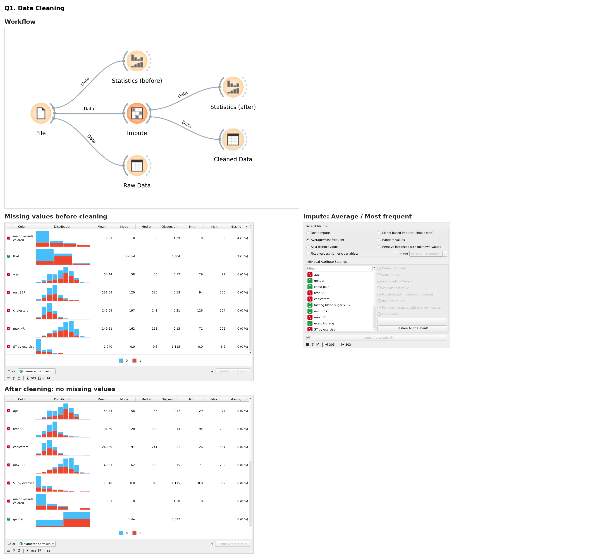
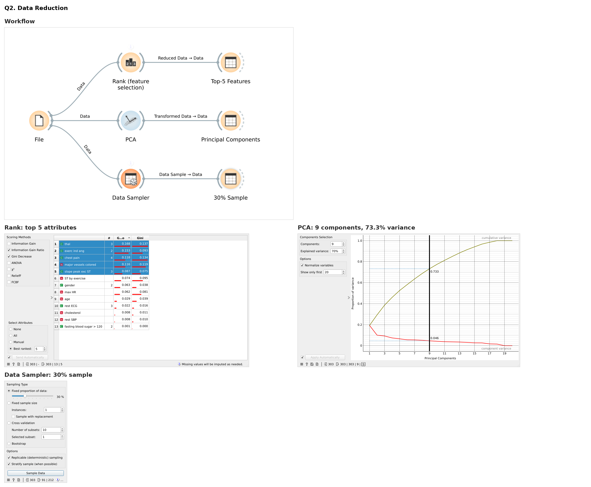
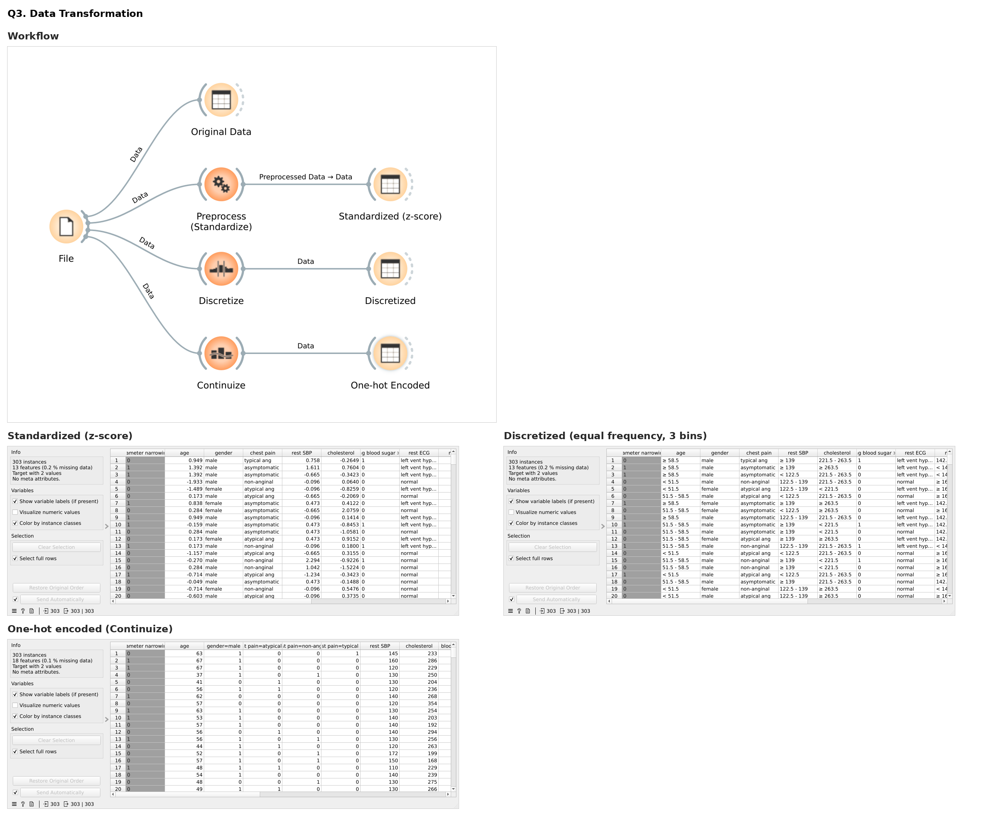
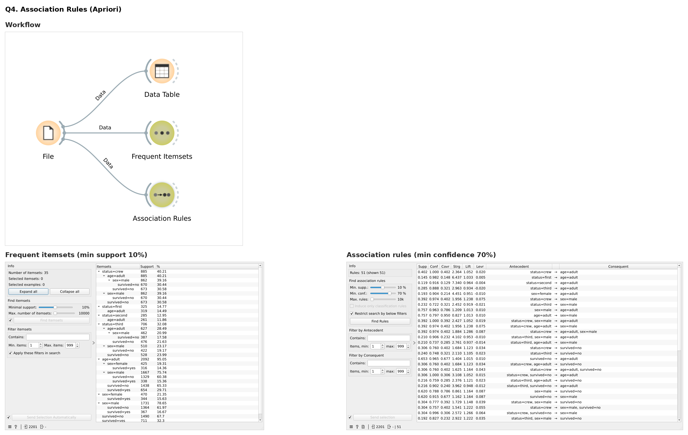
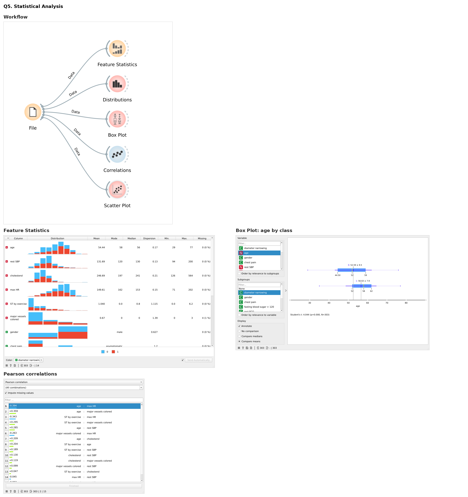
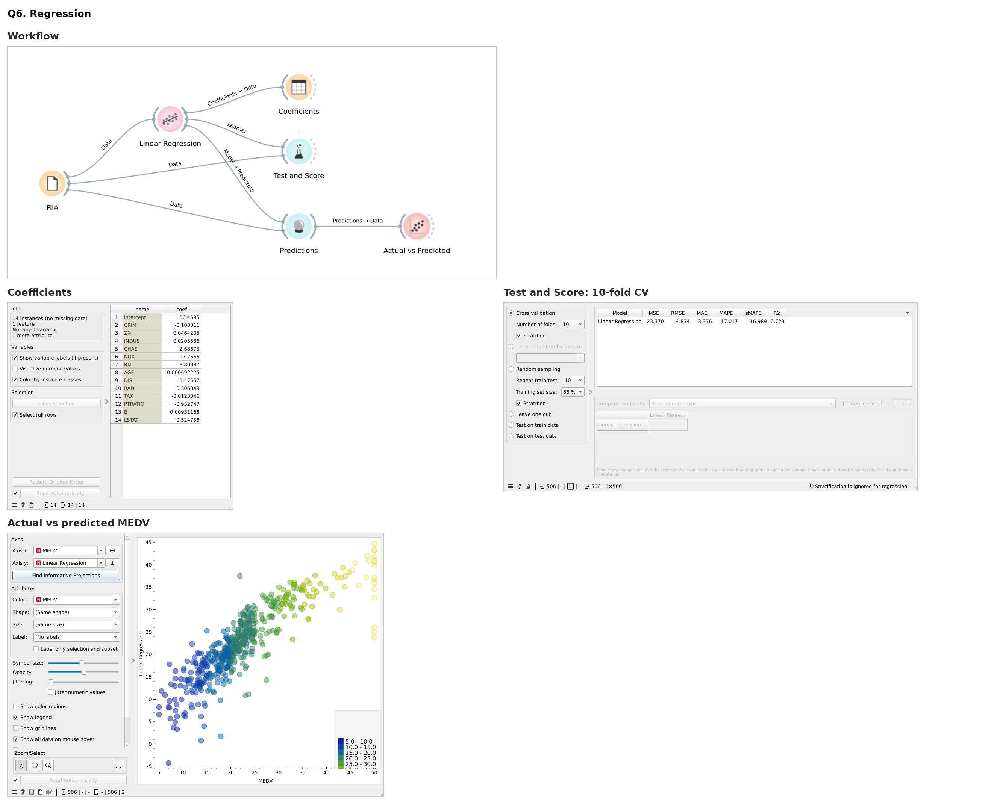
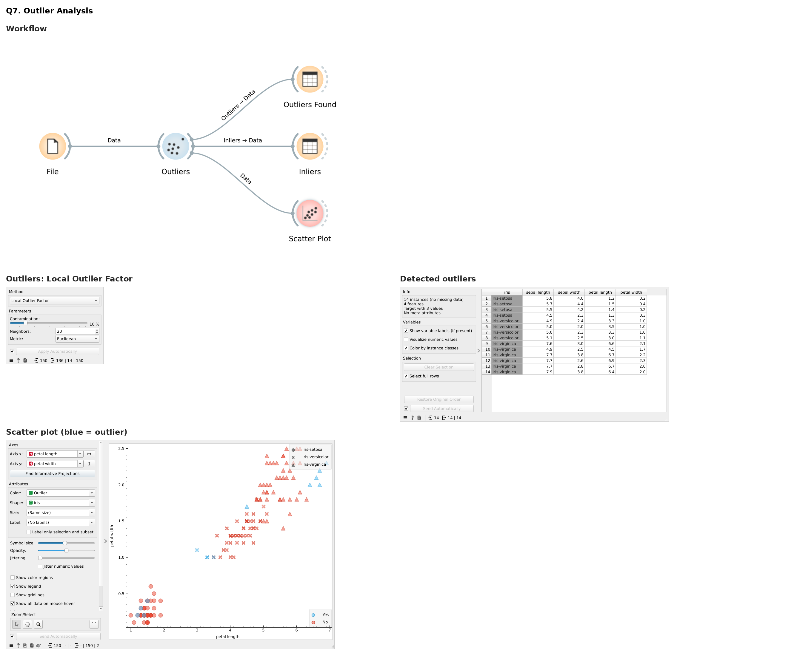
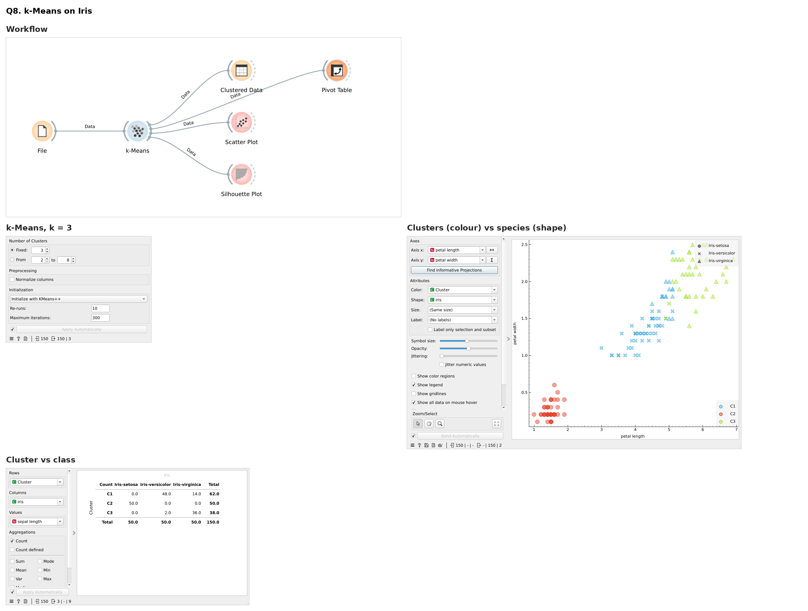
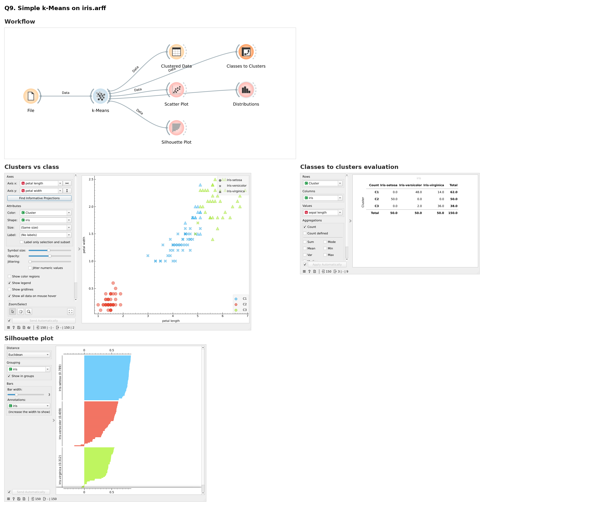

# DWDM Orange Assignment

This repository contains Orange Data Mining workflows, datasets and scripts for the 21CSE321T Data Warehousing and Data Mining assignment, along with verification screenshots.

**Tool used:** Orange Data Mining 3.40

## Project Contents

* `heart_disease.tab` - Heart disease dataset used for Questions 1, 2, 3 and 5.
* `titanic_items.csv` - Titanic dataset used for association rule mining in Question 4.
* `housing.tab` - Boston housing dataset used for regression in Question 6.
* `iris.tab` - Iris dataset used for Questions 7 and 8.
* `iris.arff` - Iris dataset in Weka ARFF format used for Question 9.
* `iris_from_arff.csv` - `iris.arff` converted to CSV so Orange can open it.
* `arff_to_csv.py` - Script that converts `iris.arff` to CSV.
* `apriori.py` - Apriori algorithm script used to verify the association rules from Question 4.
* `workflows/` - Orange workflow (`.ows`) for each question.
* `screenshots/` - Screenshot verification for Questions 1 to 9.

## How to Run

1. Install Orange Data Mining from https://orangedatamining.com/download
2. For Question 4, install the Associate add-on: **Options → Add-ons → Associate**, then restart Orange.
3. Open any file from `workflows/` with **File → Open**. The dataset loads automatically.

## Questions

### Q1. Data Cleaning on Dataset using Orange
**Workflow:** `workflows/q1_data_cleaning.ows`

Missing values in the heart disease dataset were found with Feature Statistics and filled with the Impute widget (mean for numeric, mode for categorical). 6 missing values were replaced.

### Q2. Data Reduction on Dataset using Orange
**Workflow:** `workflows/q2_data_reduction.ows`

Rank reduced 13 attributes to the 5 most informative ones, PCA reduced the data to 9 components keeping 73.3% of the variance, and Data Sampler reduced 303 rows to a stratified 30% sample of 91 rows.

### Q3. Data Transformation using Orange
**Workflow:** `workflows/q3_data_transformation.ows`

Numeric attributes were standardized (z-score) with Preprocess, discretized into 3 equal-frequency intervals with Discretize, and categorical attributes were one-hot encoded with Continuize.

### Q4. Generate Association Rules using Apriori Algorithm using Orange
**Workflow:** `workflows/q4_association_rules_apriori.ows`

With minimum support 10% and minimum confidence 70%, Orange found 35 frequent itemsets and 51 association rules on the Titanic dataset. `apriori.py` produces the same 51 rules. Strongest rule: `sex=female → survived=yes` (confidence 0.73, lift 2.27).

### Q5. Demonstrate Statistical Analysis on Data set using Orange
**Workflow:** `workflows/q5_statistical_analysis.ows`

Feature Statistics, Distributions, Box Plot and Correlations were used on the heart disease dataset. Patients with heart disease are older on average (t = 4.044, p < 0.001), and the strongest correlation is age vs max HR (r = -0.394).

### Q6. Demonstrate performing Regression on dataset
**Workflow:** `workflows/q6_regression.ows`

Linear Regression on the Boston housing dataset, evaluated with 10-fold cross validation: R² = 0.723, RMSE = 4.834, MAE = 3.376.

### Q7. Implementation of Outlier Analysis using Orange
**Workflow:** `workflows/q7_outlier_analysis.ows`

The Outliers widget with Local Outlier Factor (contamination 10%, 20 neighbours) found 14 outliers among the 150 Iris instances.

### Q8. Implementation of k-Means Algorithm for Iris Dataset using Orange
**Workflow:** `workflows/q8_kmeans_iris.ows`

k-Means with k = 3 produced clusters of 62, 50 and 38 instances with an average silhouette of 0.553. 134 of 150 instances (89.3%) match their true species.

### Q9. Clustering on iris.arff using Simple k-Means using Orange
**Workflow:** `workflows/q9_simple_kmeans_iris_arff.ows`

`iris.arff` was converted with `arff_to_csv.py` and clustered with k-Means (k = 3). Classes-to-clusters evaluation: 134 instances correctly clustered (89.33%), 16 incorrectly clustered (10.67%).

